# Evidencias APP1 — PedidoLab

**Repositorio:** https://github.com/andrumz29/icc-pap-pl1-patrones  
**Integrantes:** Andres Eduardo Mendez Mendez  
**Fecha:** 06/11/2026

## Casos de prueba

| ID | Operación / entrada | Resultado esperado | Resultado obtenido | Evidencia | Patrón validado |
|---|---|---|---|---|---|
| CA01 | Clonar Cafe dos veces. | IDs diferentes; ambos empiezan en $2.20. | Se generaron P-001 y P-002, con precio de $2.20 y referencias diferentes. | 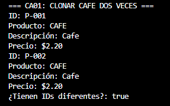 | Prototype |
| CA02 | Comparar clon y objeto del registro. | Referencias distintas; el prototipo conserva su configuración. | El clon y el prototipo son referencias distintas. Ambos mantienen precio de $2.20 y descripción Cafe. | 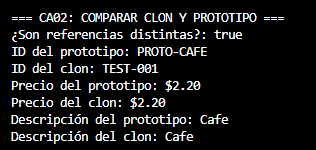 | Prototype |
| CA03 | Al primer Cafe agregar Azúcar y Crema. | Descripción incluye ambos ingredientes; total $3.90. | La descripción muestra Cafe + Azúcar + Crema y el precio es $3.90. | 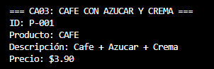 | Integración |
| CA04 | Consultar el segundo Cafe sin ingredientes. | Mantiene $2.20, sin ingredientes. | El segundo Cafe conserva la descripción Café y el precio base de $2.20. | 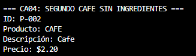 | Prototype |
| CA05 | Clonar Ensalada y agregar Tomate y Pollo. | Total $5.60. | La descripción muestra Ensalada sencilla + Tomate + Pollo y el precio es $5.60. | 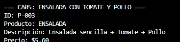 | Integración |
| CA06 | Clonar Pizza y agregar Queso y Pepperoni. | Total $7.10. | La descripción muestra Pizza sencilla + Queso + Pepperoni y el precio es $7.10. | 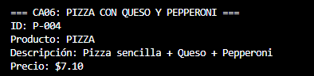 | Integración |
| CA07 | Intentar agregar Queso a Cafe. | Operación rechazada; total y descripción no cambian. | Se mostró el error de ingrediente incompatible. El precio y la descripción permanecieron iguales. | 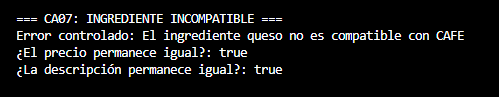 | Validación |
| CA08 | Agregar ingrediente sin pedido seleccionado. | Mensaje claro y ningún cambio de estado. | Se mostró el mensaje solicitando seleccionar un pedido. | 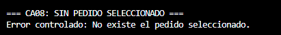 | Validación |
| CA09 | Solicitar clon de clave inexistente. | Fallo controlado; no se crea pedido. | Se mostró el error de prototipo inexistente para la clave hamburguesa. | 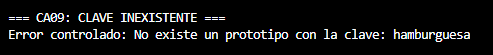 | Prototype |
| CA10 | Agregar dos veces Azúcar a un Cafe. | Total $3.20 y dos aplicaciones del decorador. | La descripción muestra Cafe + Azúcar + Azúcar y el precio es $3.20. | 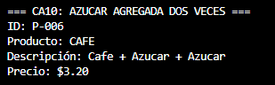 | Decorator |
| CA11 | Reiniciar y volver a clonar Cafe. | Nuevos pedidos parten nuevamente del valor base $2.20. | Despus de reiniciar no quedaron pedidos y el nuevo Caf comenzó con ID P-001 y precio $2.20. | 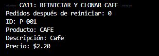 | Prototype |
---

# Evidencias fotograficas

## CA01 - Clonar Cafe dos veces

## CA02 - Comparar clon y prototipo

## CA03 - Cafe con Azúcar y Crema

## CA04 - Segundo Cafe sin ingredientes

## CA05 - Ensalada con Tomate y Pollo

## CA06 - Pizza con Queso y Pepperoni

## CA07 - Ingrediente incompatible

## CA08 - Sin pedido seleccionado

## CA09 - Clave inexistente

## CA10 - Azúcar agregada dos veces

## CA11 - Reiniciar y clonar Cafe

---

# Identificación de patrones

## Prototype

Se implementa mediante las siguientes clases e interfaces:

- `Prototipo<T>`
- `ProductoBase`
- `Cafe`
- `Ensalada`
- `Pizza`
- `RegistroPrototipos`

El registro almacena los prototipos y permite crear copias mediante el método `clonar()`, asignando un nuevo identificador a cada pedido.

## Decorator

Se implementa mediante:

- `DecoradorIngrediente`
- `Azucar`
- `Crema`
- `Tomate`
- `Pollo`
- `Queso`
- `Pepperoni`

Cada decorador recibe un pedido y lo envuelve, agregando una descripción y un costo adicional sin modificar el producto original.

## Integración

La integración se realiza en `ServicioPedidos`, específicamente en el metodo `agregarIngrediente()`, que valida la compatibilidad y aplica el decorador correspondiente al pedido seleccionado.

# Decisiones de diseño

1. Se utiliza Prototype para crear pedidos a partir de productos base registrados, asignando un ID nuevo a cada clon y evitando modificar el prototipo original.
2. Se utiliza Decorator para agregar ingredientes dinámicamente sin crear una clase distinta para cada combinación posible.
3. Se utiliza `BigDecimal` para manejar los precios y evitar problemas de precisión en los valores monetarios.
4. Se implementan validaciones para impedir ingredientes incompatibles, claves inexistentes y operaciones sin un pedido seleccionado.

# Conclusiones

1. Las pruebas muestran que los clones son independientes y que el prototipo conserva su configuración original.
2. El patrón Decorator permite agregar ingredientes, acumular sus precios y conservar la composición del pedido.
3. Las validaciones rechazan operaciones incorrectas sin modificar los pedidos existentes.
4. El reinicio permite limpiar los pedidos y comenzar nuevamente la numeración desde P-001.