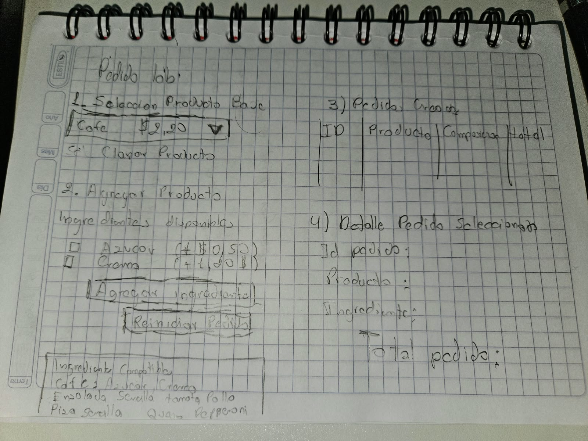

# PedidoLab

## Descripción del proyecto

PedidoLab es un proyecto desarrollado en Java que tiene como finalidad crear una aplicación para gestionar pedidos de productos personalizados. La aplicación permitirá seleccionar productos, agregar ingredientes, visualizar los pedidos y calcular el precio total.

Para desarrollar el proyecto se utilizarán los patrones de diseño Prototype y Decorator, junto con la arquitectura Modelo-Vista-Controlador (MVC), para mantener el código organizado y facilitar su desarrollo.

## Estructura de carpetas y paquetes

El proyecto está organizado en diferentes paquetes para separar las responsabilidades de cada parte de la aplicación.

- **modelo:** contiene las clases Producto, Ingrediente y Pedido, que representan la información principal de la aplicación.
- **vista:** contiene la clase VentanaPrincipal, donde posteriormente se desarrollará la interfaz gráfica utilizando Java Swing.
- **controlador:**     contiene la clase PedidoController, encargada de gestionar las acciones del usuario.
- **patrones:** contiene las clases necesarias para trabajar con los patrones de diseño:
  - **prototype:** incluye ProductoPrototype y ProductoConcreto, que servirán para crear copias de productos.
  - **decorator:** incluye ProductoDecorator e IngredienteDecorator, que permitirán agregar ingredientes y personalizar los productos.
- **servicio:** contiene la clase PedidoService, donde se organizarán las operaciones relacionadas con los pedidos.
- **Main.java:** será la clase principal desde donde se iniciará la aplicación.

